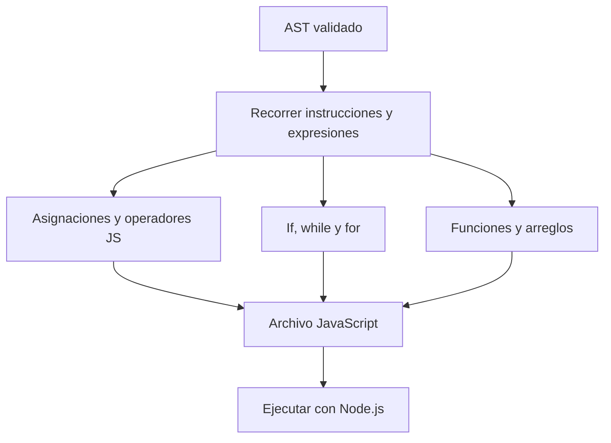
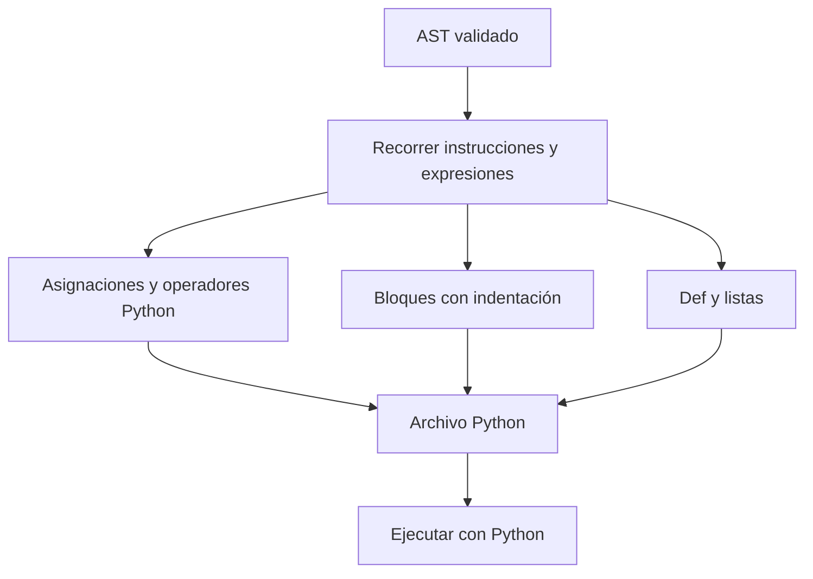

# Fase 3 - Generación de código

## Resumen de análisis

El lexer reconoce tokens y posiciones. El parser utiliza precedencia de operadores y construye el AST. El análisis semántico registra identificadores, tipos y ámbitos, comprueba llamadas y condiciones. Si una etapa falla se evita continuar con las siguientes para reducir errores derivados. El reporte incluye sugerencias.

## Recorrido del AST

JavaScript:

Python:

Los dos generadores comparten el recorrido y seleccionan la sintaxis del destino. Los nombres se prefijan para evitar conflictos con palabras reservadas. Los arreglos del pseudocódigo empiezan en 1; se comprueba el índice antes de convertirlo a base 0. Las funciones tienen parámetros y variables locales. Leer acepta entradas numéricas, como los ejemplos oficiales.

## Evidencias para la defensa

1. Ejecutar npm test y revisar los resultados de cada prueba.
2. Mostrar el AST de C: For, Assignment y Binary; el de D: ArrayDeclaration, Index, For e If.
3. Quitar las comillas finales de una cadena; revisar el error léxico.
4. Quitar FinPara de C; revisar el error y la sugerencia.
5. Probar una variable inexistente, declaración duplicada, tipo incompatible y llamada con argumentos insuficientes.
6. Mostrar la tabla de E: base y altura en CalcularArea y en global.
7. Compilar los cinco archivos y ejecutar los casos en ambos lenguajes. Verificar los resultados de npm test.
8. Modificar una operación y comprobar que cambia el código y la salida.

## Alcance

Se conserva el pseudocódigo del anexo sin alterar su lógica. D inicializa max en cero; para entradas exclusivamente negativas se necesitaría cambiar ese pseudocódigo. No se pretende soportar todo lenguaje de programación: se trabaja con el subconjunto de la gramática del proyecto. Las comprobaciones de tipos de parámetros sin declaración son parciales; algunos errores dependen de los valores de ejecución. Las pruebas no demuestran ausencia de todos los posibles errores. Los casos oficiales comparan las líneas finales esperadas, no los mensajes de solicitud de entrada.

La evidencia de ejecución del entorno de revisión está en pruebas_fase3.txt. Completar carátula, integrantes y enlace real del repositorio en el informe de entrega.
